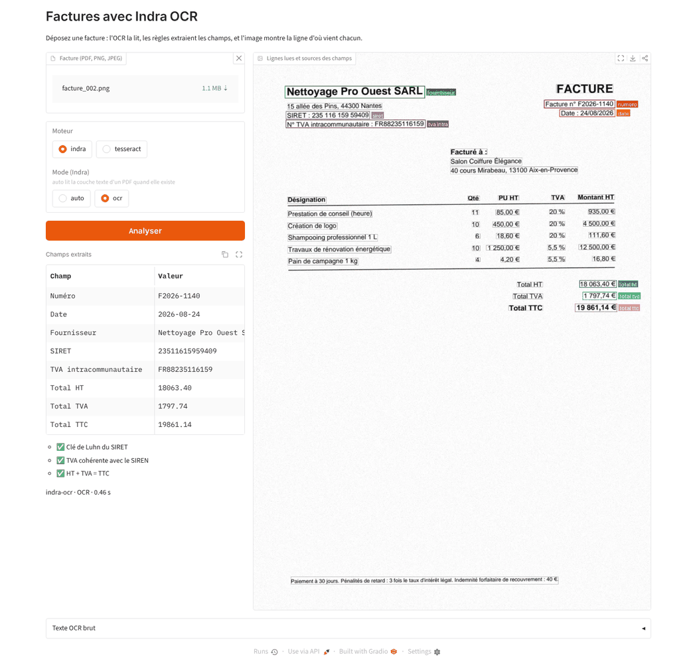

# Factures_Ocr_Indra

Je m'amuse à tester le nouveau modèle Indra OCR sur des factures.

[Indra OCR](https://github.com/datalab-to/indra) est un modèle OCR d'un million de paramètres
publié par Datalab en octobre 2026. Il tourne sur CPU, sans GPU ni PyTorch, et rend pour chaque
page du Markdown ou du JSON avec les lignes, leurs boîtes et les blocs de mise en page.
Ce dépôt teste s'il suffit pour extraire les champs d'une facture française :
numéro, date, fournisseur, SIRET, TVA intracommunautaire, lignes et totaux.

## Démarche

1. **Factures synthétiques** avec vérité terrain : chaque facture existe en PDF numérique
   (couche texte) et en scan simulé (image légèrement tournée, floue et bruitée).
2. **OCR** avec Indra (et Tesseract pour comparer).
3. **Extraction** des champs, d'abord par règles, puis par un LLM local.
4. **Contrôles** : clé de Luhn du SIRET, cohérence TVA intracommunautaire / SIREN, HT + TVA = TTC.
5. **Mesure** : temps par page et exactitude champ par champ, Indra contre Tesseract.

Le plan jour par jour est dans [docs/PLAN.md](docs/PLAN.md).

## Premiers résultats (2 novembre 2026)

20 factures synthétiques, OCR forcé partout (la couche texte des PDF n'est pas lue), extraction
des 8 champs d'en-tête par règles, sur un runner GitHub Actions standard (4 cœurs, sans GPU).
Le [workflow du banc](.github/workflows/bench.yml) refait ce tableau à chaque modification.

| Moteur | Documents | Mots retrouvés (F1) | Champs justes | Factures parfaites | Temps médian / page |
|---|---|---:|---:|---:|---:|
| Indra | PDF numérique | 99,8 % | 100 % | 20/20 | 314 ms |
| Indra | scan léger | 99,5 % | 100 % | 20/20 | 326 ms |
| Indra | scan moyen | 93,3 % | 95,6 % | 14/20 | 330 ms |
| Indra | scan fort | 66,3 % | 66,2 % | 0/20 | 438 ms |
| Tesseract 5 | PDF numérique | 95,9 % | 98,8 % | 18/20 | 512 ms |
| Tesseract 5 | scan léger | 95,2 % | 97,5 % | 16/20 | 716 ms |
| Tesseract 5 | scan moyen | 79,8 % | 79,4 % | 4/20 | 537 ms |
| Tesseract 5 | scan fort | 36,4 % | 11,9 % | 0/20 | 561 ms |

- Sur un document propre, Indra est parfait et 1,6 à 2 fois plus rapide que Tesseract.
- Plus le scan se dégrade, plus l'écart se creuse : sur un scan moyen, 14 factures entièrement
  justes contre 4. Le point faible d'Indra à ce niveau est le petit numéro de facture en haut à
  droite (6 ratés sur 20).
- Sur un scan très abîmé (110 dpi, flou, JPEG fort), aucun moteur ne suffit.
- Extraction par LLM (Qwen2.5 3B, local) : en-tête aussi bon que les règles mais 40 s par
  facture ; lignes du tableau justes sur 8 factures sur 20, car Indra rend les cellules dans le
  désordre.

Limite : ce sont des factures générées, avec deux gabarits ; de vraies factures seront plus
variées.

## Démo



Une mini-interface Gradio : on dépose une facture (PDF ou image), on choisit le moteur, et on voit
les champs extraits, les trois contrôles et, sur l'image, la ligne d'où vient chaque champ.
La capture montre la vraie sortie d'Indra sur un scan simulé (`facture_002`), lue dans GitHub
Actions en 0,46 s.

```bash
pip install -e ".[demo,ocr]"
factocr demo                          # http://127.0.0.1:7860, exemples tirés de data/
```

## Démarrage

```bash
pip install -e ".[dev]"
factocr generer --nombre 20          # data/numerique, data/scan, data/verite
pip install -e ".[ocr]"
factocr ocr data --mode ocr          # sorties/ocr/indra-ocr/…/*.json
factocr extraire sorties/ocr/indra-ocr   # règles : CSV + exactitude par champ
factocr extraire sorties/ocr/indra-ocr --methode llm --modele qwen2.5:3b   # LLM local (Ollama)
factocr generer --niveaux moyen,fort  # + scans plus abîmés (scan_moyen, scan_fort)
pip install -e ".[tesseract]"        # et le paquet système tesseract-ocr-fra
factocr bench data                   # Indra contre Tesseract : mots, champs, temps
pytest
```

## Licences

Le code de ce dépôt est sous licence MIT. Le code d'Indra est sous Apache 2.0 ; ses poids sont
sous OpenRAIL-M modifiée, gratuits pour la recherche, l'usage personnel et les structures de moins
de 20 M$ de chiffre d'affaires ou de levée (voir [datalab.to/pricing](https://www.datalab.to/pricing)).
Toutes les factures du dépôt sont fictives.
